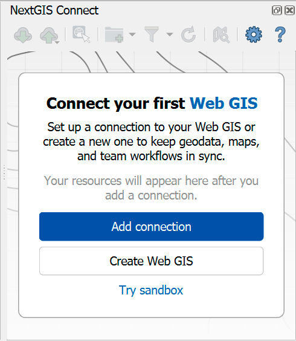
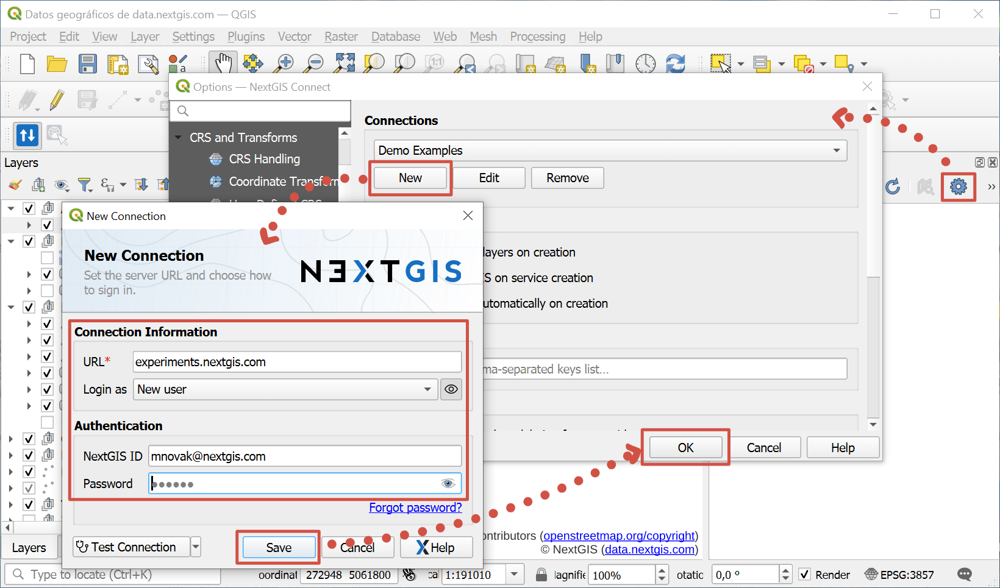
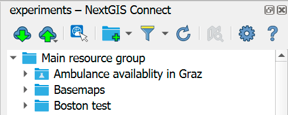
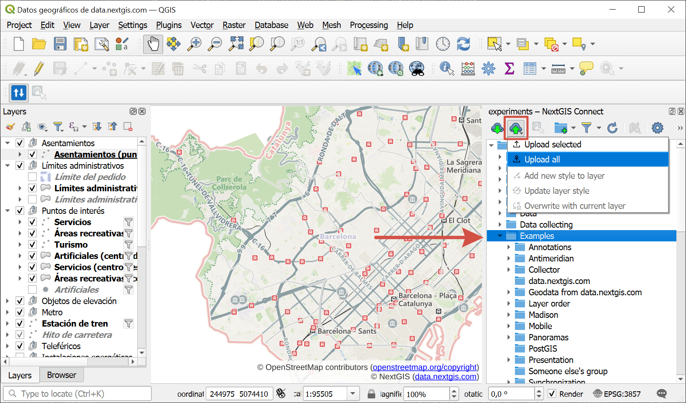
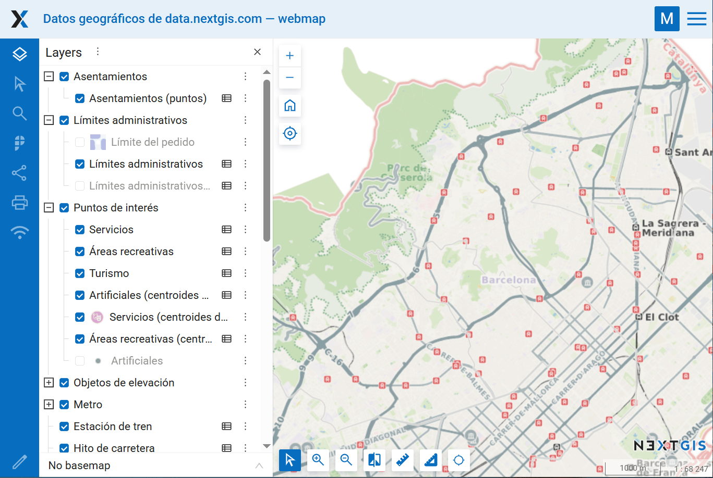

.. _data_connect_to_ngw:

How to upload data to NextGIS Web with NextGIS Connect
======================================================

* `Order data <https://data.nextgis.com/en/>`_ for your area of interest in Geopackage format (QGIS).
* Go to the `orders <https://data.nextgis.com/en/orders/actual/>`_ page and download the archive when it's complete. 
* **Unpack** the archive.
* Download and install `QGIS <https://qgis.org/en/site/forusers/download.html>`_.
* Launch QGIS.
* Drag the project file "data_reseding.qgs" into QGIS window.

The project is loaded in QGIS.

.. figure:: _static/open_project_qgis_drag_en.png
   :name: open_map1
   :align: center
   :width: 20cm
   
* Install **NextGIS Connect** plugin (top menu Plugins - Manage and install plugins - enter *NextGIS Connect* in the search bar - Install). 

* NextGIS Connect panel will appear. You can also call this panel via |connect_logo| button from the toolbar. 

* Add connection to your Web GIS.

.. admonition:: Don't have a Web GIS yet?

   `How to create your Web GIS in a few clicks <https://docs.nextgis.com/docs_ngcom/source/create_webgis.html>`_

1. Click on the gear icon to open Settings.

2. In the Connections section create a **new** connection (enter URL of your Web GIS and, if needed, login and password of your NextGIS ID). 

3. Click **Save**, then **OK**, and close the Settings menu. In the NextGIS Connect panel you'll see appear the entire resource tree of your Web GIS.

 

4. Select the *resource group* where you want to upload your project, click **Add to Web GIS** |button_cloud_upload| in the plugin toolbar and select **Upload all**.

After a while a newly created Web Map opens in the default browser.

