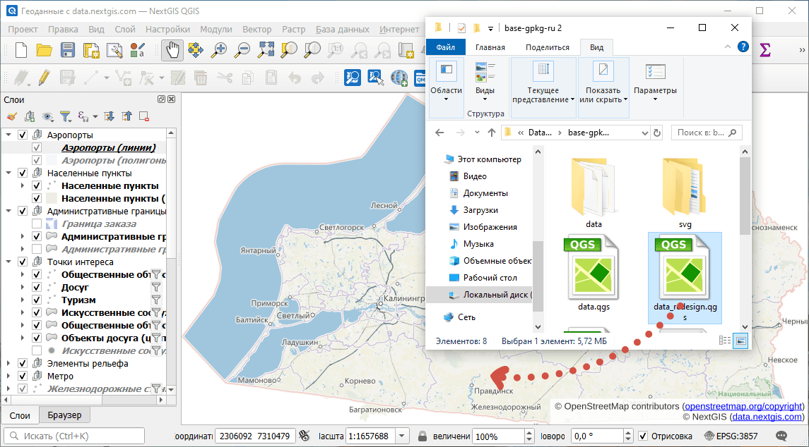
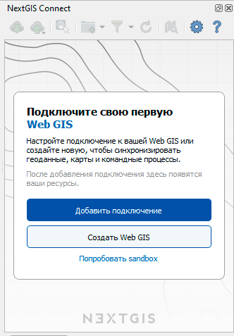
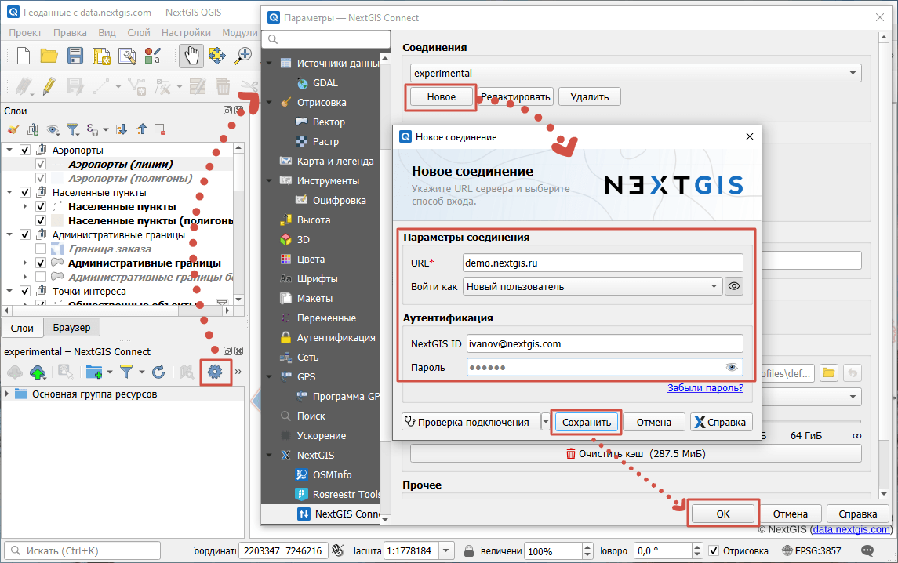
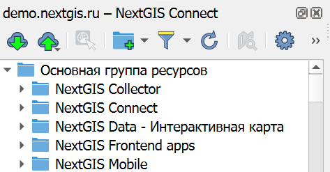
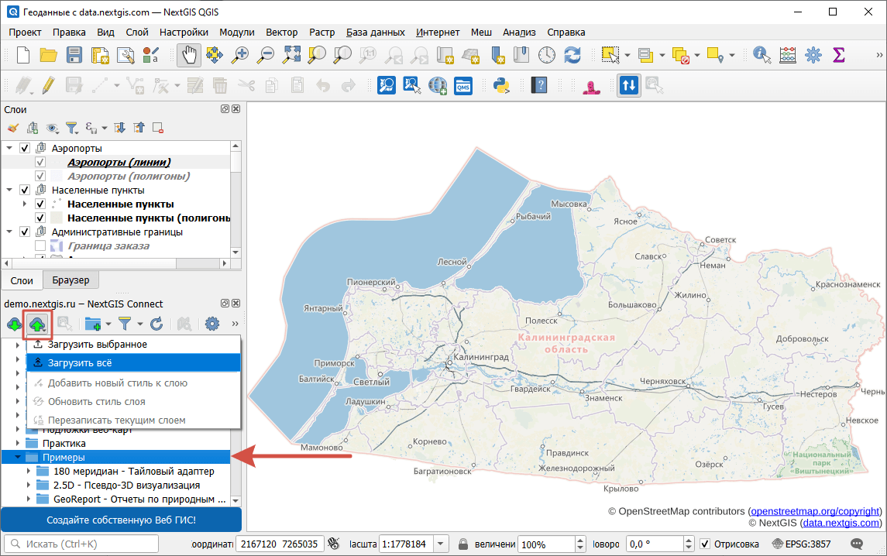
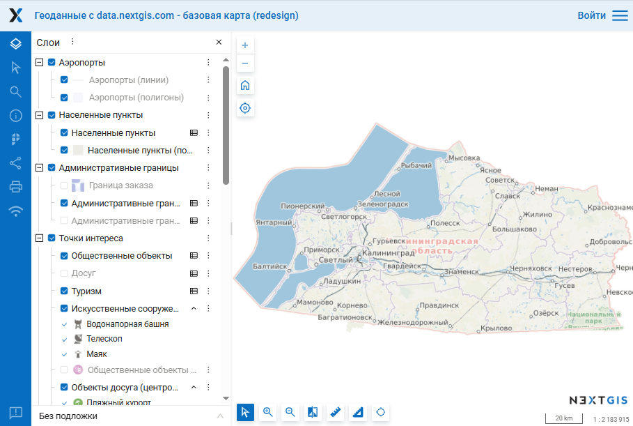

.. _data_connect_to_ngw:

Как загрузить данные в NextGIS Web (NextGIS Connect)
====================================================

* `Закажите данные <https://data.nextgis.com/ru/>`_ на интересующую территорию в формате GeoPackage (QGIS).
* Дождитесь получения результата, `скачайте <https://data.nextgis.com/ru/orders/actual/>`_ и **распакуйте** архив с данными.
* Скачайте и установите `NextGIS QGIS <https://nextgis.ru/nextgis-qgis/>`_ или обычный QGIS.
* Запустите QGIS.
* Перетащите файл проекта «data_redesign.qgs» в окно QGIS.

В результате проект будет полностью загружен в QGIS.

   
* Установите модуль **NextGIS Connect** (Меню - Модули -Управление модулями - Ввести в поиске *NextGIS Connect* - Установить). В NextGIS QGIS модуль уже установлен, нужно его только обновить до последней версии.

* Появится панель модуля NextGIS Connect. Также панель можно открыть при помощи кнопки |connect_icon| на панели инструментов. 

* **Настройте** подключение к вашей Веб ГИС:

.. admonition:: Ещё нет своей Веб ГИС?

   `Как быстро создать Веб ГИС <https://docs.nextgis.ru/docs_ngcom/source/create_webgis.html>`_

1. Нажмите на кнопку настроек (шестеренка на панели).

2. В открывшейся панели в разделе Соединения создайте **новое** подключение (укажите URL вашей Веб ГИС и при необходимости логин/пароль NextGIS ID). 

3. Нажмите **Сохранить**, **ОК**, затем закройте окно настроек. В панели модуля появятся все ресурсы вашей Веб ГИС.

 

4. Выберите *группу ресурсов*, в которую вы хотите поместить ваш проект, нажмите на кнопку |button_cloud_upload| **Добавить в Веб ГИС** в панели модуля и выберите **Загрузить всё**.

Через некоторое время откроется веб-карта с настроенным проектом.

.. |button_cloud_upload| image:: _static/button_cloud_upload.png
   :width: 7mm
   :alt: облако со стрелкой вверх