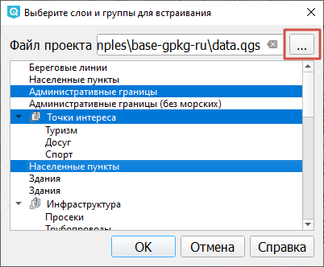
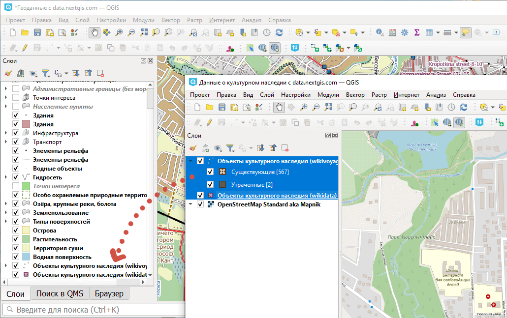

Как объединить два проекта в один
=================================

* `Закажите данные <https://data.nextgis.com/ru/>`_ на интересующую территорию в формате GeoPackage (QGIS).
* Дождитесь получения результата, `скачайте <https://data.nextgis.com/ru/orders/actual/>`_ и **распакуйте** архив с данными.
* Скачайте и установите `NextGIS QGIS <https://nextgis.ru/nextgis-qgis/>`_ или обычный QGIS.
* Запустите QGIS.
* Перетащите файл первого проекта «data_redesign.qgs» в окно QGIS.

.. figure:: _static/open_project_qgis_drag_ru.png
   :name: open_map1
   :align: center
   :width: 20cm

* В главном меню выберите Слой → Встроить слои и группы.
* В появившемся окне выберите файл второго проекта. 

   Выбор слоёв и групп для добавления в проект. Выбранные отмечены синим

* В поле ниже появится список слоёв и групп слоёв. Выберите среди них нужные или выделите всё нажатием Ctrl+A. Нажмите **ОК**.

Выбранные слои и группы слоёв будут добавлены в проект.

Другой способ объединить проекты:

* Откройте два окна QGIS рядом. В одном - один проект, в другом - второй.

* Перетащите группы слоёв из одного проекта в другой. Они будут перенесены вместе со стилями и подписями.

