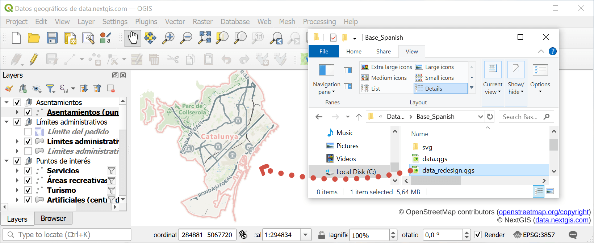
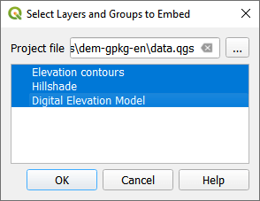
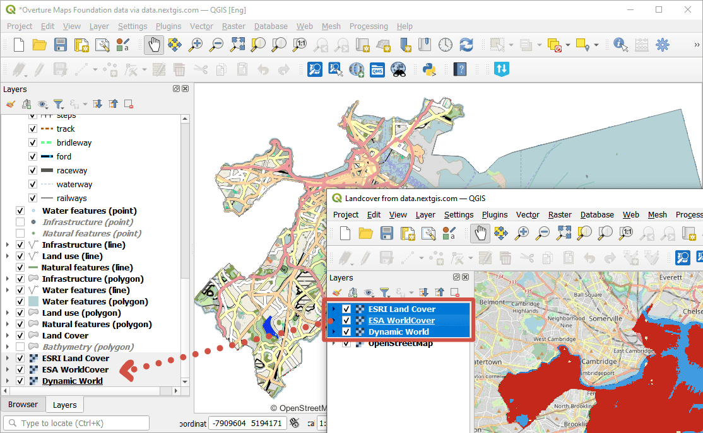

How to combine two projects into one
=====================================

* `Order data <https://data.nextgis.com/en/>`_ for your area of interest in Geopackage format (QGIS).
* Go to the `orders <https://data.nextgis.com/en/orders/actual/>`_ page and download the archive when it's complete. * **Unpack** the archive.
* Download and install `QGIS <https://qgis.org/en/site/forusers/download.html>`_.
* Launch QGIS.
* Drag the first project file "data_redesign.qgs" into QGIS window.

* In the main menu, select Layer → Embed Layers and Groups.
* In the pop-up window, select the file of the second project. 

   Selecting layers and groups to add to the project (marked in blue).

* A list of layers and layer groups appears in the field below. Select the ones you need or press Ctrl+A to select all. Click **OK**.

Selected layers and layer groups will be added to the project.

Another way to combine projects:

* Open two QGIS windows side by side. Open one project in each window.

Drag layer groups from one project to another. Styles are added automatically.

