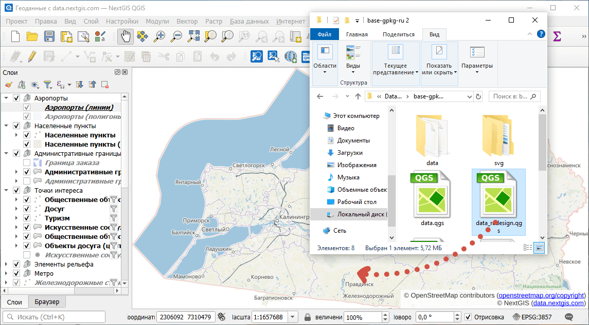

.. _data_open_map:

Как открыть карту (проект) целиком
==================================

* `Закажите данные <https://data.nextgis.com/ru/>`_ на интересующую Вас территорию в формате GeoPackage (QGIS).
* Дождитесь получения результата, `скачайте <https://data.nextgis.com/ru/orders/actual/>`_ и **распакуйте** архив с данными (извлеките данные из архива).
* Скачайте и установите `NextGIS QGIS <https://nextgis.ru/nextgis-qgis/>`_, можно также использовать обычный QGIS.
* Запустите QGIS. 
* Перетащите файл проекта «data_redesign.qgs» в окно QGIS.

* Проект будет добавлен в QGIS; данные готовы к работе.

