How to order data
====================

.. _data_area:

Select area
----------------------

You can select your area of interest in one of several ways:

1. Browse the `catalog <https://data.nextgis.com/en/catalog/subdivisions/>`_. Select a region to view its boundaries and prices. 

2. Type the name of the region into the `search bar <https://data.nextgis.com/en/>`_ on the main page or `on the map <https://data.nextgis.com/en/region/custom/base>`_ of the custom area page.

3. You can also `draw a custom polygon area <https://data.nextgis.com/en/region/custom/base/>`_ on the map or upload a boundary from a file.

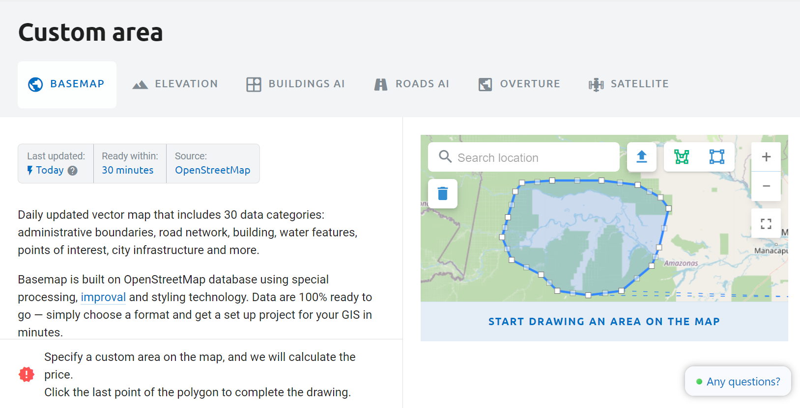

* |button_area_rect| - draw a rectangle to select area;
* |button_area_draw| - draw a custom polygon to select;
* |button_data_upload| - upload boundaries from file;
* |button_clear_area| - clear selection;
* |button_area_fullscreen| - full-screen map mode.

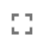

.. _data_type:

Select data type
-------------------

If you've chosen a region from the catalog, you'll see the cards of all products available for this region. Select the product you need.

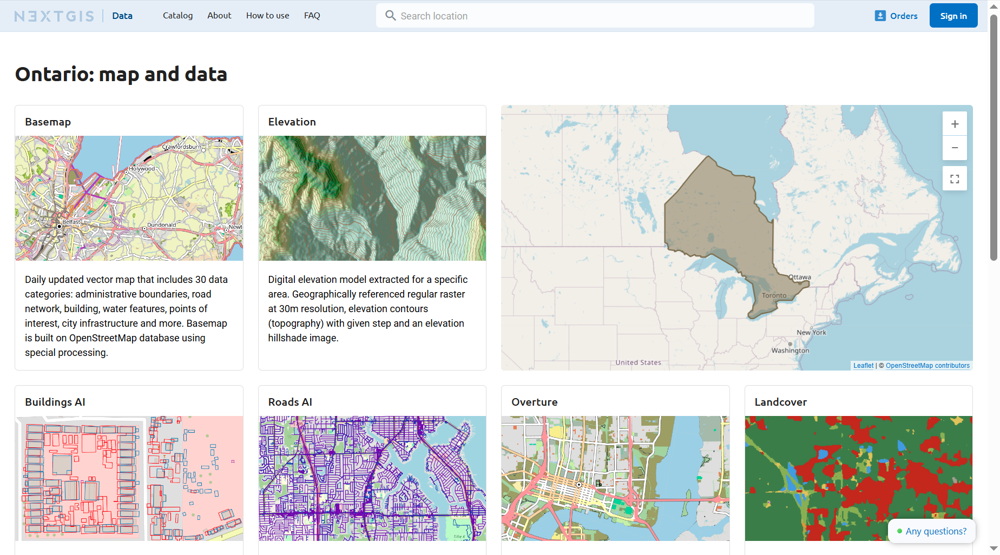

   Product cards on the region page

The product page opens. It's the same type of page you get if you select a custom area.

To switch between products, use the dropdown menu.

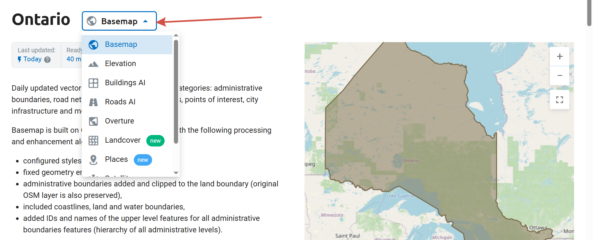

   Selecting product

Data types you can order:

* `OpenStreetMap Basemap <https://data.nextgis.com/en/region/custom/base/>`_
* `Ouverture Basemap <https://data.nextgis.com/en/region/custom/overture/>`_
* `Elevation <https://data.nextgis.com/en/region/custom/dem/>`_
* `Buildings AI <https://data.nextgis.com/en/region/custom/msbld/>`_
* `Roads AI <https://data.nextgis.com/en/region/custom/msrd/>`_
* `Satellite <https://data.nextgis.com/en/region/custom/sat/>`_
* `Heritage <https://data.nextgis.com/en/region/custom/heritage/>`_

On each page you can download samples and check out data structure.

.. _data_format:

Select format
---------------

Select format from a dropdown menu. 

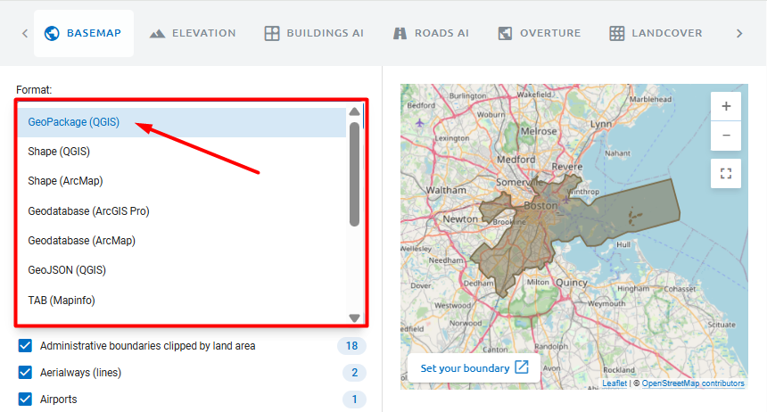

By default vector data is in GeoPackage (QGIS).

You can view the list of formats for each data type and download `samples <https://data.nextgis.com/en/about/#formats>`_ in all available formats.

.. _data_layers:

Select layers
--------------

Data sets contain one or more layers. See the data structure to find what kind of information is stored in each layer.

Hover over the layer name to see a sample screenshot. Keep in mind that it is only an illustration, data for a particular area may have no features in that layer.

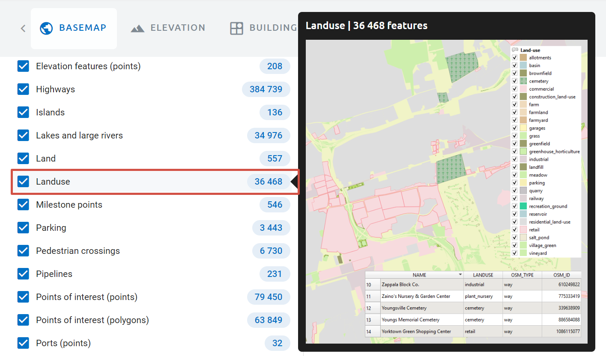

For OSM Basemap and Elevation you can choose which layers to order and deselect others.

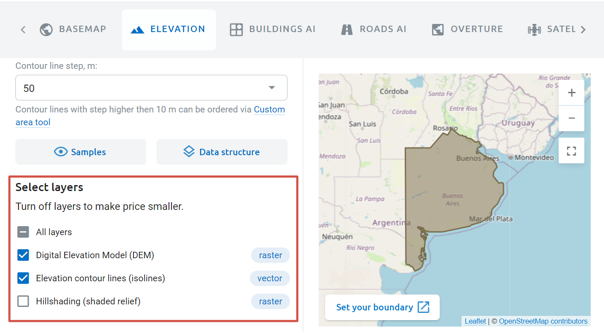

For Elevation you can also choose contour line step.

.. _data_cart:

Cart and checkout
-----------------------------------------------

After selecting an area you'll see the price and the order details at the bottom of the page. 

* Click **Add to Cart** if you plan to add more regions or products. 
* Click **Order** to proceed directly to checkout.

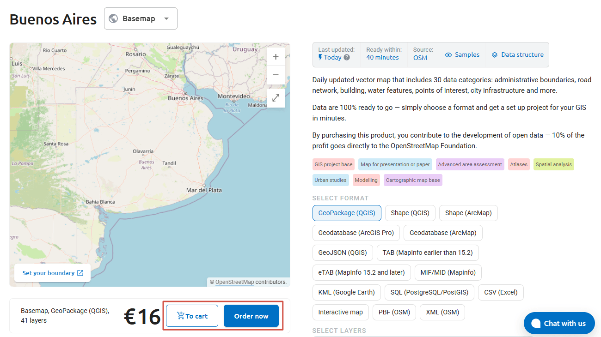

To view the contents of your cart, hover your mouse over the |icon_cart| icon in the upper right corner of the screen.

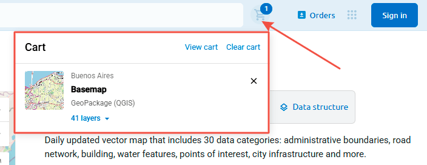

From the pop-up window, you can **View cart** and **Clear cart**.

If you don't have a NextGIS ID account yet, you will be prompted to register once you open the cart page. You can also simply enter your email address and complete account creation later.

After registering or logging into an existing account, the "Email address" field will be filled in automatically.

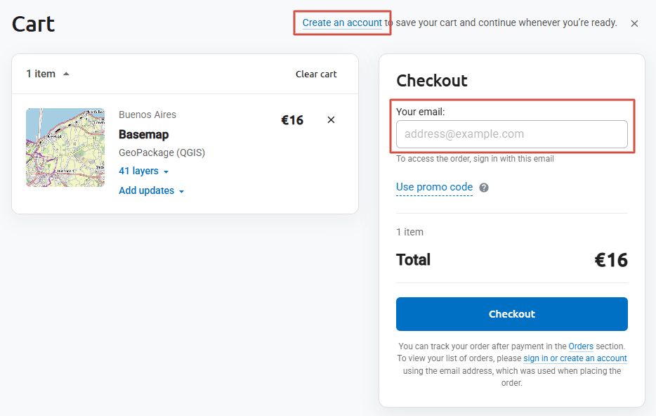

   Guest cart

Check the details of your order. Make sure the format is indicated correctly. 

Some parameters can be changed directly in the cart:

* change included layers (e.g., in the Basemap);
* add updates (for Basemap);
* if you order data as of a specific past month, you can change this date.

To change other parameters, you need to remove the product from the cart and add it again. This will be required for the following changes:

* file formats;
* contour line step when ordering DEM.

If you have a **promo code**, enter it in the corresponding field. 

The payment is made in euros, if your card has another currency, the conversion is handled by the bank. If you’re purchasing data on behalf of the organisation, we can issue an invoice addressed to this organisation. `More on payment methods <https://data.nextgis.com/en/faq/#pay>`_

After checking all parameters, click **Checkout**. You will be redirected to the payment page. After successful payment, the `orders page <https://data.nextgis.com/en/orders/actual/>`_ will open. Here you can track the status of uploads and download the result.

.. _data_donwload:

Download data
------------------

Log in to data.nextgis.com. If you don't have NextGIS ID yet, sign up using the email address you entered for your data order.

After signing in click **Orders** in the top right corner. It will open your order history. In this section you can find all the orders made for that particular email address. You can see if the order is ready and download the data. Also you can repeat older orders to get actualized data for the same area.

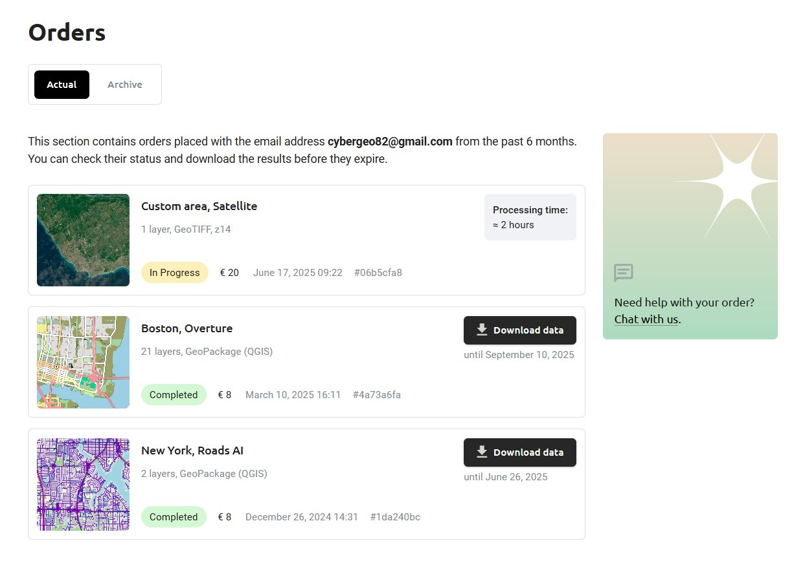

